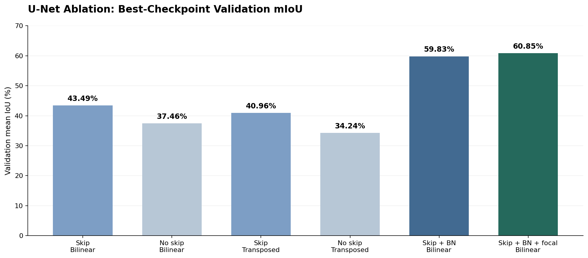
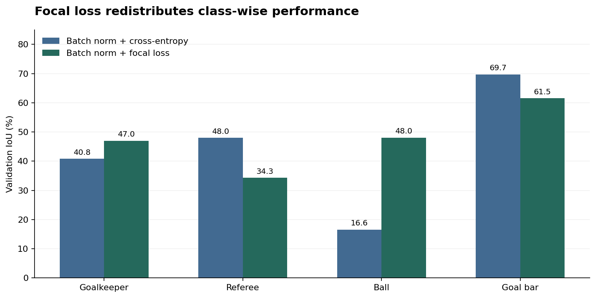
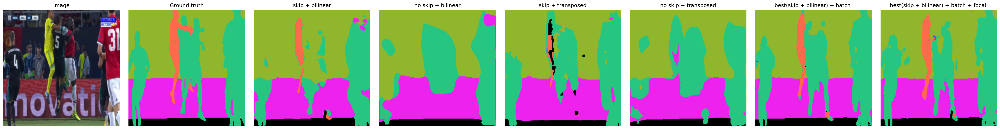
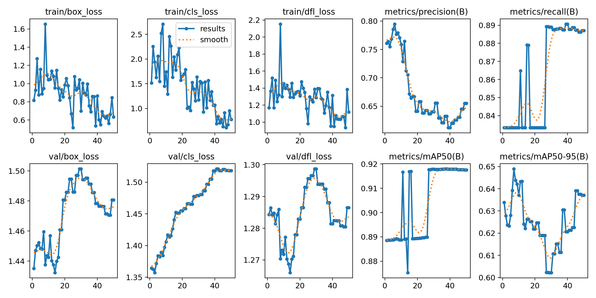

# Football Scene Understanding with U-Net

**A controlled study of encoder–decoder design, normalization, and loss functions for nine-class semantic segmentation**  
*PyTorch · Semantic segmentation · Ablation studies · Class imbalance · Transfer learning*

This repository investigates how architectural and optimization choices affect **pixel-level understanding of football broadcast imagery**. I built a configurable U-Net pipeline, harmonized two differently annotated football datasets into one label space, and evaluated six model configurations under a consistent training and validation protocol. A separate experiment explores **YOLOv8n transfer learning on COCO8** as a small-scale object-detection sanity check; its results are **not** directly comparable to the football segmentation task.

**Headline result:** The strongest segmentation configuration—**skip connections + bilinear upsampling + batch normalization + focal loss**—achieved **60.85% validation mIoU** on a **20-image** holdout, compared with **43.49%** for the corresponding U-Net baseline. All numbers below are taken from the saved experiment logs, not estimated from figures.

<p align="center">
  
</p>

## Research questions

1. **Information flow:** Do U-Net skip connections improve localization compared with a decoder that reconstructs features without encoder skips?
2. **Decoder design:** How does bilinear interpolation followed by convolution compare with learned transposed convolution?
3. **Optimization:** Does adding batch normalization improve convergence and validation segmentation quality?
4. **Class imbalance:** Can focal loss improve difficult, infrequent categories such as the ball, goalkeeper, and referee, and what trade-offs does it introduce?

## Method

### Data integration and preprocessing

The pipeline supports **two football datasets with different file conventions and RGB label palettes**. It matches each image with its segmentation mask, handles RGB and RGBA masks, and converts dataset-specific colors into **nine shared semantic classes**:

| ID | Unified class | Label harmonization |
| ---: | --- | --- |
| 0 | Background | Background / field / ground |
| 1 | Player | Team 1 / Team 2 / Team A / Team B |
| 2 | Goalkeeper | Both goalkeeper labels in each dataset |
| 3 | Referee | Referee |
| 4 | Ball | Football / ball |
| 5 | Goal bar | Goal bar |
| 6 | Advertisement | Advertisement |
| 7 | Audience | Spectators / audience |
| 8 | Staff | Coaches and officials (available in dataset 2) |

Because mask pixels may not exactly match their palette colors, each pixel is assigned to the **nearest known RGB color** of its source dataset, then mapped to the common label ID:

```math
k^{\star}(x) = \arg\min_{k} \sum_{c \in \{R,G,B\}} \bigl(m_c(x)-r_{k,c}\bigr)^2,
\qquad \hat{y}(x) = f\bigl(k^{\star}(x)\bigr)
```

Here, `m` is a mask pixel, `r` is a reference palette color, and `f` maps palette entries to unified class IDs. The implementation uses 32-bit integer arithmetic for color-distance calculations to avoid overflow.

Images are resized to **256 × 256** using bilinear interpolation; masks use **nearest-neighbor** resizing to preserve categorical labels. RGB images are scaled to `[0, 1]` without additional mean/std normalization in the reported experiments. A seeded **90/10 split within each source dataset** produces **180 training and 20 validation images** in total (seed `42`). This balances representation of *dataset sources*, not pixel-class frequencies.

Class imbalance is substantial: in the training masks, **background accounts for 45.50% of pixels**, whereas the **ball accounts for only 0.17%**, motivating a loss-function comparison. Aggregate class frequencies are provided in [`docs/results/class_distribution.json`](docs/results/class_distribution.json).

### Segmentation architecture

The implementation in [`models/model.py`](models/model.py) follows a **five-level U-Net-style encoder–decoder**:

- **Encoder:** two 3 × 3 convolution–ReLU operations per stage, with optional batch normalization, and four 2 × 2 max-pooling operations.
- **Feature widths:** 64 → 128 → 256 → 512 → **1024 at the bottleneck** (default configuration).
- **Decoder:** four resolution-restoring stages using either **bilinear upsampling + 3 × 3 convolution** or **2 × 2 transposed convolution**.
- **Skip ablation:** concatenate the corresponding encoder features with decoder features, or disable those connections to isolate their effect.
- **Prediction head:** a 1 × 1 convolution outputs **nine class logits per pixel**, followed by `argmax` at inference time.

The same model implementation supports all six experiments via configuration changes; no independently pretrained segmentation backbone is used.

### Objective functions and evaluation

The baseline objective is pixel-wise multiclass cross-entropy. The focal-loss experiment uses the hard-example reweighting of [Lin et al. (2017)](https://openaccess.thecvf.com/content_iccv_2017/html/Lin_Focal_Loss_for_ICCV_2017_paper.html):

```math
\mathcal{L}_{\mathrm{CE}} = -\frac{1}{|\Omega|}\sum_{i\in\Omega}\log p_{i,y_i}
```

```math
\mathcal{L}_{\mathrm{focal}} = -\frac{1}{|\Omega|}\sum_{i\in\Omega}(1-p_{i,y_i})^{\gamma}\log p_{i,y_i},
\qquad \gamma=2
```

Here, `Ω` denotes valid labeled pixels and `p` is the predicted probability for the ground-truth class. The reported focal-loss run uses **no class-specific alpha weights** (`focal_alpha: null`). The loss is implemented directly in [`utils/losses.py`](utils/losses.py), rather than through a third-party focal-loss package.

Performance is measured using the accumulated validation confusion matrix. For class `c`:

```math
\mathrm{IoU}_c=\frac{TP_c}{TP_c+FP_c+FN_c},
\qquad
\mathrm{mIoU}=\frac{1}{|\mathcal{C}_{\mathrm{present}}|}
\sum_{c\in\mathcal{C}_{\mathrm{present}}}\mathrm{IoU}_c
```

The code averages IoU across **ground-truth-present classes** and also reports **pixel accuracy**. The best checkpoint of each run is selected by validation mIoU; this is a *validation* comparison, not an independent test-set estimate.

## Experiments and results

All segmentation runs use **Adam**, learning rate **1e-4**, batch size **4**, **30 epochs**, no weight decay, 256 × 256 inputs, and the same seeded data split. The first four models form a skip-connection × upsampling ablation; batch normalization and focal loss are then introduced sequentially to the strongest baseline.

| Model | Skip connections | Upsampling | Batch norm | Loss | Val. mIoU ↑ | Pixel accuracy ↑ |
| --- | :---: | --- | :---: | --- | ---: | ---: |
| U-Net / bilinear | Yes | Bilinear | No | CE | 43.49% | 91.58% |
| No-skip / bilinear | No | Bilinear | No | CE | 37.46% | 88.16% |
| U-Net / transposed | Yes | Transposed conv | No | CE | 40.96% | 92.34% |
| No-skip / transposed | No | Transposed conv | No | CE | 34.24% | 89.60% |
| U-Net / bilinear + BN | Yes | Bilinear | Yes | CE | 59.83% | **96.05%** |
| **U-Net / bilinear + BN + focal** | **Yes** | **Bilinear** | **Yes** | **Focal** | **60.85%** | 95.44% |

**Observations**

- **Skip connections matter:** adding encoder–decoder skips improves mIoU under both upsampling strategies in this experiment.
- **Bilinear decoding wins on mIoU:** with and without skips, it outperforms the tested transposed-convolution variant, though transposed convolution sometimes yields higher pixel accuracy.
- **Batch normalization drives the largest gain:** the skip + bilinear model rises from **43.49% to 59.83% mIoU**, a **16.34-percentage-point** improvement.
- **Focal loss produces a smaller net improvement:** adding it increases mIoU from **59.83% to 60.85%**, but decreases pixel accuracy from **96.05% to 95.44%**.

### Performance on difficult classes

The value of focal loss is clearer at the class level: **ball IoU rises from 16.59% to 48.03%** and goalkeeper IoU rises from **40.82% to 46.98%**, while referee IoU **falls from 47.98% to 34.29%**. Thus, improvement is **not uniform** across the rare categories.



The *staff* class is especially unreliable: the supplied validation class histogram contains **only two staff pixels**, and all six models score **0 IoU** on that class. These results should not be interpreted as robust performance estimates for staff segmentation.

### Qualitative segmentation comparisons

The image below juxtaposes a football frame, its ground-truth mask, the four architectural ablations, and the batch-normalized / focal-loss variants. It is one qualitative example, not a replacement for the aggregate metrics.



[See an additional wide-field validation example](docs/assets/segmentation_field_example.png).

Machine-readable, path-sanitized results are available in [`docs/results/segmentation_validation.json`](docs/results/segmentation_validation.json).

## Separate experiment: YOLOv8n transfer learning

To also exercise a pretrained object-detection workflow, [`scripts/yolo_finetune.py`](scripts/yolo_finetune.py) fine-tunes **YOLOv8n** on **[COCO8](https://docs.ultralytics.com/datasets/detect/coco8)** for **50 epochs**, at **640 × 640** resolution, with the **first 10 layers frozen**. This uses **4 training and 4 validation images** from COCO; it is **not a football object-detection benchmark**.

| COCO8 validation metric | Final epoch (50) |
| --- | ---: |
| Box precision | 65.53% |
| Box recall | 88.71% |
| mAP@0.50 | 91.76% |
| mAP@0.50:0.95 | 63.71% |



[View a COCO8 detection example](docs/assets/yolo_validation_prediction.jpg) · [Recorded metrics](docs/results/yolo_coco8_summary.json)

**Interpretation:** COCO8 is intended as a tiny pipeline verification dataset; its four-image validation set is far too small to support claims of generalizable detection performance. The segmentation and detection evaluations also measure different tasks and must not be compared numerically.

## Reproduce the experiments

### 1. Install dependencies

Use **Python 3.10+**. From the repository root, create and activate a virtual environment, then install the libraries used by the code:

```bash
python -m venv .venv
source .venv/bin/activate   # Windows: .venv\Scripts\activate
python -m pip install torch numpy pillow pyyaml tqdm matplotlib ultralytics
```

For GPU installation of PyTorch, follow the [official PyTorch installer](https://pytorch.org/get-started/locally/) for your hardware. Exact dependency versions were **not captured** in the supplied experiment archive.

### 2. Supply the football datasets

The images and masks are **not distributed** with this repository. Place legitimately obtained data in the configured directories, or edit [`config/config.yaml`](config/config.yaml) to point to your own dataset locations:

```text
data/dataset/
├── dataset1/
│   ├── images/
│   │   └── 1.png
│   └── masks/
│       └── 1.png
└── dataset2/
    └── images/
        ├── Frame 1 (1).jpg
        └── Frame 1 (1).jpg___fuse.png
```

The last filename is **intentional**: the configured dataset-2 mask suffix is `___fuse.png` appended to the *full original image filename*, including `.jpg`. If your masks use a different suffix, change `data.dataset2.mask_suffix` in the YAML file.

### 3. Train, evaluate, and visualize

Run commands from the **repository root**, in this order:

```bash
# Inspect the source-aware split and pixel-class frequencies
python scripts/analyze_data.py

# Train the 2 × 2 architectural ablation (four runs)
python scripts/main.py

# Add batch normalization to skip + bilinear
python scripts/train_bn.py

# Replace cross-entropy with focal loss (gamma = 2)
python scripts/train_focal.py

# Evaluate best checkpoints and plot all six predictions
python scripts/evaluate.py --q_final

# Generate additional metric comparison plots
python scripts/plot_model_comparison.py
```

Outputs are written to `models/saved_models/` (segmentation checkpoints) and `outputs/` (histories, generated figures, evaluation JSON). Those working directories are ignored by `.gitignore`; the **curated figures and aggregate metrics linked in this README** are preserved under `docs/` so they remain visible on GitHub.

For the independent COCO8 check:

```bash
python scripts/yolo_finetune.py
```

Ultralytics can download its pretrained weights and COCO8 data when required. **Note:** YOLO settings used in this experiment are explicitly set inside `scripts/yolo_finetune.py`, so editing the `yolo` section of the YAML file alone does not change that training call.

### Project layout

```text
config/config.yaml               # Segmentation configuration and four baseline experiments
data/data_loader.py             # Pairing, palette harmonization, per-source splitting
models/model.py                 # Configurable U-Net encoder and decoder
scripts/main.py                # Baseline experiment runner
scripts/train.py               # Shared training / checkpoint logic
scripts/train_bn.py            # Batch normalization experiment
scripts/train_focal.py         # Focal-loss experiment
scripts/evaluate.py            # Checkpoint evaluation and visual comparisons
scripts/plot_model_comparison.py  # Analysis plots
scripts/yolo_finetune.py       # Separate COCO8 transfer-learning experiment
utils/losses.py                # Multiclass focal loss
utils/metrics.py               # Confusion matrix, IoU, Dice, pixel accuracy
utils/visualization.py         # Prediction and diagnostic plots
docs/assets/                   # GitHub-visible qualitative and quantitative figures
docs/results/                  # Curated, path-sanitized experiment summaries
```

## Limitations and research directions

This is a **course-scale empirical investigation**, not a claim of state-of-the-art performance. The two football datasets have different annotation conventions, the held-out set contains only 20 images, and all segmentation comparisons use one random seed. No independent test set, repeated-seed confidence intervals, or cross-dataset generalization analysis was included. Near-identical colors in some original palettes may also complicate nearest-color mask decoding.

Natural follow-up studies would include **per-dataset evaluation**, multiple seeds, spatial/data augmentation, class-aware sampling or weighted losses, explicit uncertainty intervals, and higher-resolution models for very small objects. These would make it easier to distinguish genuine architectural gains from sampling and annotation effects.

## References

- Ronneberger, O., Fischer, P., & Brox, T. (2015). [*U-Net: Convolutional Networks for Biomedical Image Segmentation*](https://arxiv.org/abs/1505.04597).
- Ioffe, S., & Szegedy, C. (2015). [*Batch Normalization: Accelerating Deep Network Training by Reducing Internal Covariate Shift*](https://proceedings.mlr.press/v37/ioffe15.html). ICML.
- Lin, T.-Y., Goyal, P., Girshick, R., He, K., & Dollár, P. (2017). [*Focal Loss for Dense Object Detection*](https://openaccess.thecvf.com/content_iccv_2017/html/Lin_Focal_Loss_for_ICCV_2017_paper.html). ICCV.
- Lin, T.-Y., et al. (2014). [*Microsoft COCO: Common Objects in Context*](https://arxiv.org/abs/1405.0312).
- Ultralytics. [*COCO8 dataset documentation*](https://docs.ultralytics.com/datasets/detect/coco8) and [*training configuration*](https://docs.ultralytics.com/modes/train).
